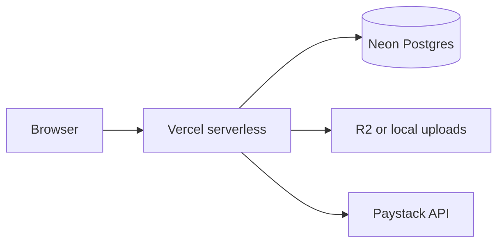

# Architecture — Media Extensions

Monorepo: **client** (Vite + React 19) and **server** (Express + Drizzle + Neon Postgres).

## Request flow

- Storefront calls `/api/*` with session cookies (`connect-pg-simple` on Postgres, signed cookies on Vercel via [vercelSession.ts](server/src/middleware/vercelSession.ts)).
- Checkout creates orders; Paystack webhook/verify marks paid via [orders service](server/src/services/orders.ts).
- Staff routes under `/api/staff` require `admin`, `manager`, or `technician` (repairs-only).

## Key modules

| Area | Location |
|------|-----------|
| Schema | [server/src/db/schema.ts](server/src/db/schema.ts) |
| Auth + MFA | [server/src/routes/auth.ts](server/src/routes/auth.ts) |
| Payments ledger | `payment_records` (orders + repairs) |
| Store config | [server/src/lib/storeConfig.ts](server/src/lib/storeConfig.ts) + Staff settings |
| Notifications | [server/src/lib/notify.ts](server/src/lib/notify.ts) |

## Deploy

Vercel root `server`, static client in `client/dist`. See [VERCEL.md](VERCEL.md) and [RUNBOOK.md](RUNBOOK.md).
